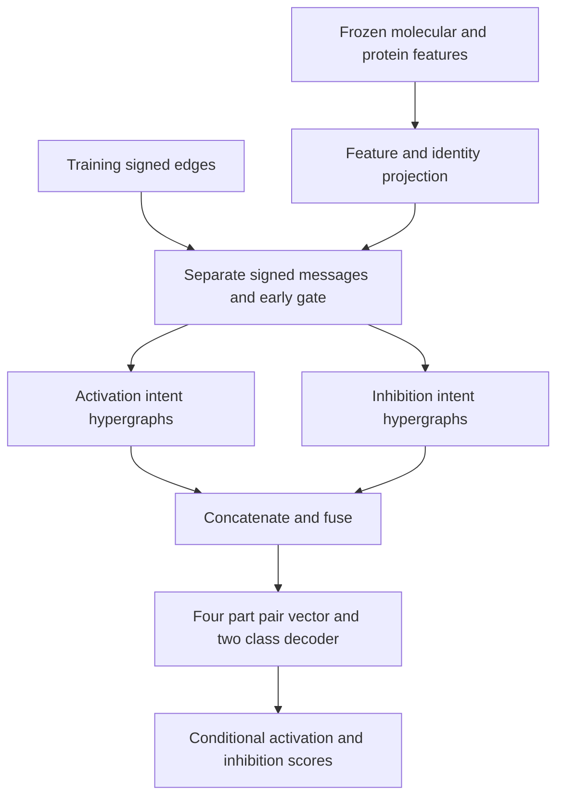

# RegSignHG revision implementation

This package supplies executable training, evaluation, prediction, data checks,
and manuscript-to-code mappings for a **new revision implementation** of
RegSignHG. It was prepared after auditing earlier CSIH code bundles.
It is **not a recovered snapshot of the code that produced the submitted
paper**, and it does not establish that any published table has been reproduced.
The included configuration values are examples, not verified original settings.


## Installation

Use a new Python 3.12 environment. CPU validation uses PyTorch 2.5.1+cpu.

```bash
python -m venv .venv
```

Activate with `source .venv/bin/activate` on Linux/macOS, or
`.venv\Scripts\activate` in Windows Command Prompt.

```bash
python -m pip install torch==2.5.1 --index-url https://download.pytorch.org/whl/cpu
python -m pip install -r requirements.txt
python -m unittest discover -s tests -v
```

GPU execution and the optional pretrained feature extractors require separate
verification on the intended machine. For a CUDA installation, obtain the
matching PyTorch build using the official instructions; do not describe the
CPU smoke test as GPU verification.

## Software smoke test

The script creates random synthetic entities. Its scores are NOT biomedical
results and must not enter a manuscript table.

```bash
python scripts/make_toy_data.py --out data/toy
python scripts/audit_data.py --data-dir data/toy --allow-synthetic
python train.py --config configs/smoke.yaml --output outputs/smoke --allow-synthetic
python evaluate.py --checkpoint outputs/smoke/seed_7/fold_1/best.pt --allow-synthetic
python scripts/export_hypergraphs.py --checkpoint outputs/smoke/seed_7/fold_1/best.pt --output outputs/smoke/members.csv --allow-synthetic
```

Output directories must be new; use another output path when repeating a run.

## Real inputs

Each dataset directory contains exactly these required input files:

| File | Contents |
|---|---|
| `interactions.csv` | Canonical `drug,gene,sign`; sign is exactly `+1`/`1` or `-1` |
| `drug_features.npz` | String `ids`, float `features`, scalar JSON string `metadata` |
| `gene_features.npz` | Same keys, using gene IDs matched to the chosen protein isoforms |
| `provenance.json` | Dataset name, source version, original source files, processing description, synthetic flag |

Duplicate pairs, conflicting signs, missing feature IDs, object/pickle arrays,
nonfinite features and incomplete provenance are rejected. Features are aligned
by explicit IDs; sorted interaction IDs are never silently assumed to match NPY
row order. There is no identity-matrix or random-feature fallback for real data.
The main model accepts declared label-independent Uni-Mol and ESM-2 features.
Metadata is an auditable assertion, not proof that a feature was actually
extracted by its declared encoder; retain checkpoint hashes and generation logs.

Full schema and construction instructions: [data/README.md](data/README.md).

```bash
python scripts/audit_data.py --data-dir data/DGIdb --output dgidb_audit.json
python scripts/compare_datasets.py data/DGIdb/interactions.csv data/DrugBank/interactions.csv data/LINCS_L1000/interactions.csv --output cross_dataset_audit.json --fail-on-identical
python train.py --config configs/dgidb.yaml --output outputs/dgidb_revision
python train.py --config configs/drugbank.yaml --output outputs/drugbank_revision
python train.py --config configs/lincs.yaml --output outputs/lincs_revision
```

No genuine DGIdb, DrugBank or LINCS inputs or model weights are bundled.
Raw-source construction, identifier standardization, directional dictionaries,
conflict resolution and LINCS context aggregation must be supplied and audited
before calling these processed-input commands reproducible dataset construction.

## Training and outputs

The five stratified edge folds and inner validation subsets are fixed using a
split seed, separately from model initialization seeds. Only training edges
enter signed message passing and the contrastive views. The current protocol
is **transductive edge cross-validation**, with label-independent features for
the full entity universe. It does not implement entity cold-start experiments.

Early stopping selects the best validation AUC. The test split is scored only
after loading that selected checkpoint. The decision threshold is fixed in the
configuration; it is never selected from test labels.

| Output | Purpose |
|---|---|
| `resolved_config.json` | Full resolved settings and ablation choice |
| `environment.json` | Python/packages, hardware, source hashes and available Git revision |
| `data_audit.json` | Input hashes, counts, feature provenance and source metadata |
| `all_splits.json` | Exact zero-based row indices for all folds |
| `seed_X/fold_Y/history.csv` | Individual loss terms and validation AUC per epoch |
| `seed_X/fold_Y/best.pt` | Validation-selected state dict, input fingerprints and mapping |
| `seed_X/fold_Y/test_predictions.csv` | Entity IDs, true sign and both class probabilities |
| `seed_X/fold_Y/validation_predictions.csv` | Validation predictions at the selected checkpoint |
| `seed_X/fold_Y/metrics.json` | Metrics recomputed from those test probabilities |
| `runs.csv` and `summary.json` | Per-run values and explicitly labelled descriptive summaries |

One seed reports fold sample standard deviations. Multiple seeds also report
the sample standard deviation of seed means. These are different quantities;
the script does not treat folds or seeds as independent datasets or fabricate
significance tests.

The checkpoint evaluator verifies original input SHA-256 values. To move a
run to another machine, pass `--data-dir` pointing to byte-identical inputs.

```bash
python evaluate.py --checkpoint outputs/dgidb_revision/seed_1/fold_1/best.pt --data-dir data/DGIdb
python predict.py --checkpoint outputs/dgidb_revision/seed_1/fold_1/best.pt --pairs candidate_pairs.csv --output predictions.csv --data-dir data/DGIdb
```

Predictions are conditional signs for entities already present in the checkpoint.
They do not supply an interaction-existence probability or establish a novel
interaction. Unknown entities raise an error rather than silently reinitializing
an inductive model.

## Ablations

```bash
python train.py --config configs/dgidb.yaml --variant no_hyper --output outputs/dgidb_no_hyper
python train.py --config configs/dgidb.yaml --variant no_nodecl --output outputs/dgidb_no_nodecl
python train.py --config configs/dgidb.yaml --variant no_graphcl --output outputs/dgidb_no_graphcl
python train.py --config configs/dgidb.yaml --variant no_intent --output outputs/dgidb_no_intent
python train.py --config configs/dgidb.yaml --variant no_aug --output outputs/dgidb_no_aug
```

`no_hyper` actually bypasses the hypergraph and uses the pairwise signed encoder;
it is not approximated by setting the number of prototypes to one.
`no_intent` uses one intent per sign and changes parameter count.
`no_aug` removes input masking and edge dropout; ordinary network dropout remains.
It is not an ablation of an unimplemented adaptive policy.

## Architecture and manuscript alignment



During training, node contrast uses sign-preserving augmented inputs. Graph
contrast pools encoded views and contrasts them with **re-encoded corrupted
training graphs**. Shuffling final embeddings before mean pooling is not used.

Full formula mapping and implementation choices:
[docs/METHOD_CODE_MAP.md](docs/METHOD_CODE_MAP.md).
Audit of earlier archives: [docs/OLD_CODE_AUDIT_CN.md](docs/OLD_CODE_AUDIT_CN.md).

Dense node-by-prototype assignment matrices are used internally; top-r values
are masked without constructing a dense node-by-node graph. This implementation
does not claim physically sparse incidence memory or large-graph scalability.

## Optional feature extraction

Use a separate environment if upstream feature packages need other dependencies.
The extractors require genuine local pretrained checkpoints. They were written
against the official APIs but were not run with those weights in the included
software validation.

```bash
python -m pip install -r requirements-features.txt
python scripts/extract_unimol.py --input drugs.csv --checkpoint weights/unimol.pt --output data/DGIdb/drug_features.npz
python scripts/extract_esm2.py --input proteins.csv --checkpoint weights/esm2.pt --output data/DGIdb/gene_features.npz
```

Uni-Mol uses the official `UniMolRepr.get_repr` interface, upstream conformer
defaults, explicit local weight loading and CLS readout. Construction of the
upstream adapter may populate its default model cache before local weights are
loaded. A checkpoint architecture mismatch fails strictly.
ESM-2 uses final-layer mean residue embeddings, excluding special tokens.
Sequences over 1022 residues fail by default; `--long-sequence chunk` explicitly
enables a length-weighted non-overlapping chunk policy that must be reported.
Neither policy has been established as the authors' original feature pipeline.

Primary API references:

- https://unimol.readthedocs.io/en/latest/quickstart.html
- https://unimol.readthedocs.io/en/latest/train.html
- https://github.com/facebookresearch/esm

## Before using the release in a revision response

Run all genuine datasets and retain their provenance, per-run records and
predictions. Update the manuscript, figures and response according to the actual
results. Tag the exact reviewed release and include its commit in the response.
Do not claim the original Table 2 or Figures 3-5 were reproduced based on the
synthetic tests in this package. No remote repository has been changed by the
preparation of this archive.

